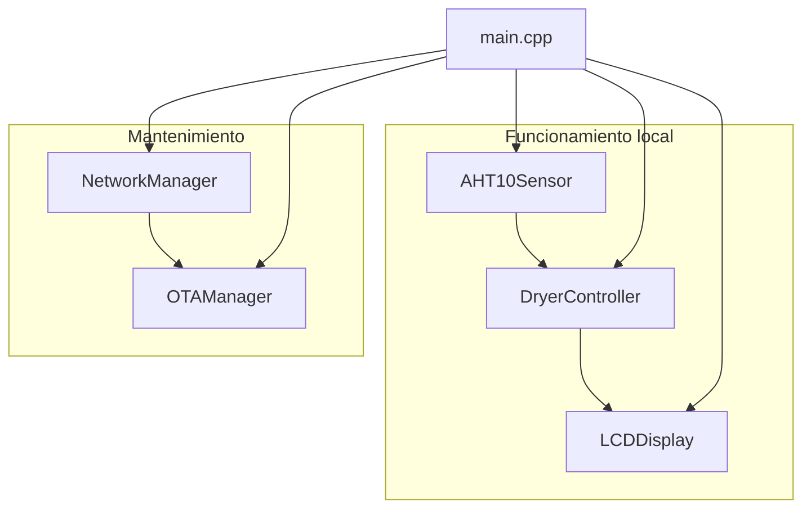

# Secador de filamento 3D

Firmware **V0.1.0** para un secador de filamento basado en **ESP-12F (ESP8266)**. Esta versión mide temperatura y humedad, las muestra en un LCD 16x2 y deja el equipo actualizable por OTA dentro de la red local.

V0.1 no controla una resistencia. No es un sistema térmico terminado. La arquitectura deja el sitio para el calefactor, pero ese control no está implementado.

## Objetivo

Supervisar el aire del secador sin que el funcionamiento local dependa del WiFi.

```text
WiFi OFF  ->  OTA OFF  ->  el sensor y el LCD siguen funcionando
OTA       =   servicio de mantenimiento, no un modo del secador
```

## Hardware V0.1

| Pieza | Detalle |
| --- | --- |
| Módulo | ESP-12F, ESP8266EX, flash 4 MB, 3,3 V |
| Sensor | AHT10, I2C `0x38`, alimentación 1,8–3,6 V |
| Pantalla | HD44780 16x2 con backpack PCF8574, I2C `0x27` |
| Bus | GPIO4 = SDA, GPIO5 = SCL, un solo maestro |

El ESP8266 **no es tolerante a 5 V**. El AHT10 tampoco admite 5 V en SDA/SCL. Un backpack de LCD alimentado a 5 V suele subir el bus con sus pull-up. Hay que resolverlo antes de conectar. El detalle está en [docs/HARDWARE.md](docs/HARDWARE.md) y [docs/WIRING.md](docs/WIRING.md).

El fabricante del AHT10 indica que no debe compartir el bus con otro dispositivo. V0.1 lo comparte con el LCD porque ese es el hardware pedido, y el firmware lo trata con transacciones completas y sin barrido del bus. No es un diseño cubierto por la hoja de datos. Si las lecturas fallan al escribir en el LCD, la corrección es de hardware (multiplexor I2C o un sensor especificado para bus compartido).

## Qué hace V0.1

- Lee el AHT10 sin bloquear el `loop()`.
- Muestra temperatura y humedad, o un error, en el LCD.
- Distingue lectura válida, sensor ausente, error de bus, tiempo de espera, falta de calibración y valor fuera de rango. Un error no se representa como `0.0`.
- Conecta a WiFi con tiempo límite y reintentos. Si no hay red, el lazo local sigue.
- Publica un hostname `FILAMENT-DRYER-XXXXXX` a partir de la MAC.
- Actualiza el firmware con ArduinoOTA y la contraseña de `secrets.h`.
- Registra el motivo del último reinicio. No desactiva el watchdog.
- Deja el actuador futuro en un contrato que arranca apagado. En V0.1 no hay actuador.

## Arquitectura

```text
Hardware  ->  Drivers  ->  Servicios  ->  Control  ->  Aplicación
I2C, AHT10, LCD          WiFi, OTA       DryerController   main.cpp
```



Más detalle en [docs/ARCHITECTURE.md](docs/ARCHITECTURE.md).

## Instalación

1. Instala [PlatformIO](https://platformio.org/) (extensión de VS Code o el comando `pio`).
2. Copia las credenciales:

```bash
cp include/secrets.example.h include/secrets.h
```

Edita `WIFI_SSID`, `WIFI_PASSWORD` y `OTA_PASSWORD`. `include/secrets.h` no se versiona. Sin ese archivo el proyecto compila, el WiFi queda apagado y el sensor sigue su curso.

3. En `platformio.ini`, entorno `esp12f_ota`, sustituye el puerto y `CHANGE_ME` por el hostname real y la misma `OTA_PASSWORD`. No subas una contraseña real si el repositorio es público.

## Compilación

```bash
pio run -e esp12f
```

La referencia de este árbol, con PlatformIO `espressif8266` 4.2.1 y el core Arduino ESP8266 3.1.2, ocupa **328364 bytes de 1044464** (31,4 %) y **31168 bytes de RAM de 81920** (38,0 %). Cabe en el hueco OTA con margen.

## Primera programación

El ESP-12F no trae USB. La primera carga es por UART a 3,3 V, con GPIO0 a nivel bajo durante el reset. El procedimiento, los pines de boot y los pads de test están en [docs/OTA.md](docs/OTA.md) y [docs/DEVELOPMENT.md](docs/DEVELOPMENT.md).

```bash
pio run -e esp12f -t upload
pio device monitor -e esp12f
```

El entorno por defecto es `esp12f` (protocolo `esptool`). No usa OTA.

## OTA

Con el equipo ya en la red y la contraseña configurada:

```bash
pio run -e esp12f_ota -t upload
```

`upload_port` acepta `FILAMENT-DRYER-A1B2C3.local` o la IP. El puerto UDP es **8266**. Solo tiene sentido dentro de la LAN. No abras ese puerto a Internet.

Si el hostname no resuelve, usa la IP que el monitor serie imprime como `IP:`. La guía completa está en [docs/OTA.md](docs/OTA.md).

## Estructura

```text
include/secrets.example.h
src/main.cpp
src/config/          versión, pines, intervalos, secretos
src/hardware/        I2C, AHT10, LCD
src/network/         NetworkManager
src/ota/             OTAManager
src/control/         DryerController y contrato Actuator
src/models/          SensorData y estados
src/utils/           log, tiempo, formato, watchdog
docs/                arquitectura, hardware, cableado, OTA, seguridad
tools/host_tests.cpp pruebas de host del decodificador
platformio.ini
```

## Documentación

| Documento | Contenido |
| --- | --- |
| [docs/ARCHITECTURE.md](docs/ARCHITECTURE.md) | Módulos, datos y ciclo |
| [docs/HARDWARE.md](docs/HARDWARE.md) | Niveles, flash, límites del AHT10 |
| [docs/WIRING.md](docs/WIRING.md) | Conexiones y modo programación |
| [docs/FIRMWARE.md](docs/FIRMWARE.md) | Compilación, tiempos, estados, logs |
| [docs/OTA.md](docs/OTA.md) | Primera carga y actualizaciones |
| [docs/SAFETY.md](docs/SAFETY.md) | Principios para cuando exista calefactor |
| [docs/DEVELOPMENT.md](docs/DEVELOPMENT.md) | Entorno, depuración, convenciones |
| [docs/TROUBLESHOOTING.md](docs/TROUBLESHOOTING.md) | Fallos frecuentes |
| [docs/ROADMAP.md](docs/ROADMAP.md) | Hacia V1.0, sin implementar esas funciones |

## Roadmap

V0.1 es la base: sensor, LCD, WiFi, OTA y el lazo de control vacío. El calefactor, el ventilador, el encoder, la persistencia y la interfaz web quedan para versiones posteriores. No están en este firmware. Ver [docs/ROADMAP.md](docs/ROADMAP.md).

## Licencia

MIT. Ver [LICENSE](LICENSE).
