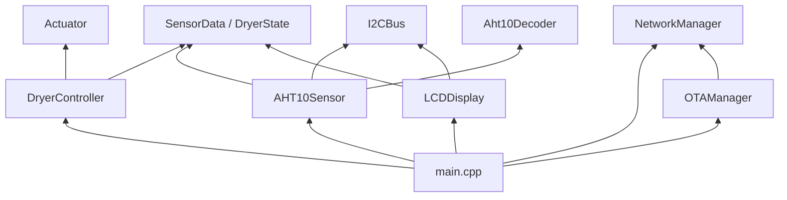

# Arquitectura

V0.1 separa el funcionamiento local del mantenimiento. El secador puede medir y mostrar datos con la radio apagada. OTA no es un estado de la máquina de secado.

## Capas

```text
Hardware
  I2CBus, pines, niveles eléctricos
    |
Drivers
  AHT10Sensor, LCDDisplay
    |
Servicios
  NetworkManager, OTAManager, Logger, Watchdog
    |
Control
  DryerController, contrato Actuator
    |
Aplicación
  main.cpp  (solo composición y el orden del loop)
```

`main.cpp` no formatea lecturas, no llama a `ArduinoOTA` y no llama a `WiFi` directamente.

## Módulos

| Módulo | Responsabilidad | No hace |
| --- | --- | --- |
| `I2CBus` | Un único `Wire.begin(SDA, SCL)`, reloj, recuperación del bus | No lee el sensor ni escribe el LCD |
| `AHT10Sensor` | Inicializa el AHT10, mide y valida | No dibuja ni decide el estado del secador |
| `LCDDisplay` | Texto 16x2 y backlight | No interpreta la política de fallos más allá de pintar lo que recibe |
| `NetworkManager` | STA, hostname, timeout, reintento | No inicia OTA |
| `OTAManager` | ArduinoOTA, contraseña, progreso, parada | No apaga un calefactor: no existe |
| `DryerController` | Estados `Initializing`, `Idle`, `SensorError` | No conmuta GPIO de potencia |
| `Actuator` | Contrato futuro: arranque en OFF y `forceOff()` | No hay clase concreta en V0.1 |
| `Logger` | `[DEBUG] [INFO] [WARN] [ERROR]` por serie | No usa red |
| `Watchdog` | Informa el motivo de reset | No llama a `wdtDisable()` |

## Dependencias



El control depende del contrato `Actuator`, no de un número de GPIO. En V0.1 el puntero es nulo.

`Aht10Decoder` no incluye cabeceras de Arduino. Las pruebas de host en `tools/host_tests.cpp` cubren la conversión y el formato decimal.

## Flujo de datos

```text
AHT10  --I2C-->  AHT10Sensor  --SensorData-->  DryerController
                                                      |
                                                      +--> LCDDisplay
                                                      |
                                                      +--> isMaintenanceAllowed()
                                                                 |
NetworkManager --enlace--> OTAManager <--------------------------+
```

`SensorData` lleva temperatura, humedad, `valid`, un estado y un `sequence`. Cada intento nuevo incrementa `sequence`. El valor `0` significa "todavía no hay muestra". Una muestra inválida usa `NAN`, no `0.0`.

El controlador publica la última muestra válida. Tras `SENSOR_MAX_FAILURES` fallos consecutivos (3) pasa a `SensorError` y el LCD deja de enseñar la cifra antigua. Un fallo aislado no borra la última lectura buena, pero el log avisa en el primer error.

## Ciclo principal

```text
setup:
  log de versión y motivo de reset
  forceSafeActuatorState()
  I2C
  LCD (si responde)
  restaurar el bus I2C
  armar AHT10
  armar el controlador
  arrancar WiFi sin esperar al resultado

loop:
  network.update()
  decidir si OTA puede arrancar y llamar a ota.update()
  si no hay una transferencia OTA en curso:
      sensor.update()
      dryer.update()
      display.update()
```

`setup()` no espera al sensor ni al WiFi. La pantalla queda en `Starting...` hasta la primera muestra o el primer fallo confirmado.

Durante una transferencia OTA el `loop` deja de tocar el bus I2C para no alargar la atención de `ArduinoOTA.handle()`.

## Decisiones

**Sin `delay()` en el lazo.** Los tiempos usan `millis()` y la resta sin signo. `delayMicroseconds()` solo aparece en la recuperación I2C, unos microsegundos. La librería del LCD sí bloquea una vez, dentro de `init()`, porque el HD44780 exige esa secuencia de arranque.

**Sin `String` en el firmware propio.** El core y ArduinoOTA usan `String` por dentro. El hostname y las líneas del LCD viven en buffers fijos.

**Driver propio del AHT10.** La librería habitual espera dentro de la medida con `delay()`. El protocolo son tres comandos y seis bytes; encapsularlo evita que el resto del programa dependa de esa librería y mantiene el `loop` cooperativo. La conversión está aislada en `Aht10Decoder`.

**Un solo dueño del bus.** `LiquidCrystal_I2C::init()` vuelve a llamar a `Wire.begin()` sin pines. Después de esa llamada, `main` ejecuta `i2cBus.restore()` para reponer GPIO4 y GPIO5. No se llama a `setClock()`: el reloj queda en el valor del core.

**OTA al margen de la máquina de estados.** No existe un estado `OTA_UPDATE`. Si en el futuro un actuador informa `isEnabled() == true`, `isMaintenanceAllowed()` devuelve false y no se llama a `OTAManager::begin()`. Eso no implementa la parada ordenada del calefactor: no hay calefactor. La secuencia completa está descrita en [SAFETY.md](SAFETY.md) y [OTA.md](OTA.md).

**Fallo de radio no es fallo de secado.** `NetworkManager` puede quedar en `Disabled` o `WaitingRetry`. El sensor y el LCD no consultan esa clase.

**Watchdog del SDK, no uno de aplicación.** El core alimenta el watchdog al volver de `loop()` y dentro de `yield()`. El firmware no lo desactiva ni lo "alimenta" para tapar un bloqueo. Ver [FIRMWARE.md](FIRMWARE.md).

## Composición

Los objetos viven en `main.cpp` con duración de programa. No hay `new` ni listas de tareas. ESP8266 se usa con el core Arduino, no con FreeRTOS.
