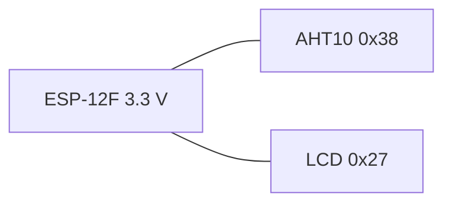

# Cableado

Todas las masas van unidas. La lógica es de 3,3 V. No conectes el bus I2C a un pull-up de 5 V. El razonamiento está en [HARDWARE.md](HARDWARE.md).

## ESP-12F

| Pin del módulo | Función en V0.1 | Notas |
| --- | --- | --- |
| VCC | 3,3 V | Fuente capaz de 500 mA o más |
| GND | Masa | Común con sensor, LCD y programador |
| EN / CH_PD | Habilitación | 10 kΩ a 3,3 V |
| RST | Reset | 10 kΩ a 3,3 V, pulsador a GND |
| GPIO0 | Boot | 10 kΩ a 3,3 V, pulsador a GND para grabar |
| GPIO15 | Boot | 10 kΩ a GND |
| GPIO2 | Boot | Sin conexión, o 10 kΩ a 3,3 V. Nunca a GND en el arranque |
| GPIO4 | SDA | I2C |
| GPIO5 | SCL | I2C |
| GPIO1 / TX | UART TX | Hacia el RX del adaptador 3,3 V |
| GPIO3 / RX | UART RX | Hacia el TX del adaptador 3,3 V |

En nomenclatura NodeMCU, GPIO4 es D2 y GPIO5 es D1. Cablea por el número de GPIO si el módulo no tiene serigrafía Dx.

## AHT10

| AHT10 | Destino |
| --- | --- |
| VDD | 3,3 V |
| GND | GND |
| SDA | GPIO4 y el resto del bus |
| SCL | GPIO5 y el resto del bus |
| NC | Sin conectar |

Añade 100 nF entre VDD y GND, junto al sensor. No lo alimentes a 5 V.

## LCD I2C

| LCD backpack | Destino |
| --- | --- |
| VCC | 3,3 V si el panel lo admite. Si necesita 5 V, solo a través de un shifter; ver abajo |
| GND | GND |
| SDA | Bus SDA del mismo dominio de tensión |
| SCL | Bus SCL del mismo dominio de tensión |

Dirección esperada: `0x27`.

## Bus compartido a 3,3 V

Úsala solo si el LCD concreto muestra caracteres con VCC a 3,3 V.

```text
                 3,3 V
                   |
                  100 nF
                   |
    +--------------+--------------+
    |              |              |
  ESP-12F        AHT10       LCD I2C
  VCC            VDD          VCC
  GND------------GND----------GND
  GPIO4----------SDA----------SDA
  GPIO5----------SCL----------SCL
                   |
              pull-up 4,7k-10k
              a 3,3 V en SDA y SCL
              (uno por línea; revisa
              si el módulo ya los trae)
```



## LCD a 5 V con shifter

```text
3,3 V                                         5 V
  |                                            |
 ESP-12F ---- SDA/SCL ----+---- AHT10     LCD backpack
                          |               VCC = 5 V
                     shifter LV            shifter HV
                     (y pull-up 3,3 V)     (pull-up del backpack a 5 V)
                          |
                         GND común
```

El AHT10 no cruza al lado de 5 V.

## Programación física

El ESP-12F es un módulo. La primera carga necesita un adaptador UART de **3,3 V** de verdad. Mide el TX del adaptador: muchos módulos marcados "3,3 V" sacan 5 V y destruyen el ESP.

| Adaptador | ESP-12F |
| --- | --- |
| TX | GPIO3 / RX |
| RX | GPIO1 / TX |
| GND | GND |
| 3,3 V | No alimentar el módulo desde aquí si la fuente es débil |

Secuencia de modo programación:

1. GPIO0 a GND.
2. Pulso bajo en RST (o ciclo de alimentación) con EN alto.
3. El adaptador ya puede enviar el binario. GPIO15 tiene que seguir a nivel bajo y GPIO2 no puede estar a masa.
4. Al terminar, suelta GPIO0 (queda alto por el pull-up) y resetea. El programa arranca.

`pio run -e esp12f -t upload` usa `esptool` a 115200 baudios. Si el adaptador cablea DTR y RTS como una NodeMCU, el reset automático puede funcionar. Un módulo desnudo normalmente exige la secuencia manual. Cuando la herramienta diga que está esperando, haz el pulso de RST con GPIO0 bajo.

La placa de producto no tiene por qué llevar USB. Para fabricar y reparar bastan pads de test: 3V3, GND, TX, RX, GPIO0, RST y EN. No son el método de actualización del usuario. Eso es OTA.

## Qué no cablear en V0.1

No hay pin de resistencia, ventilador, encoder, botones ni buzzer. No asignes uno "mientras tanto": un GPIO de boot o un pin que glitchee en el reset puede encender un SSR en cuanto exista.
